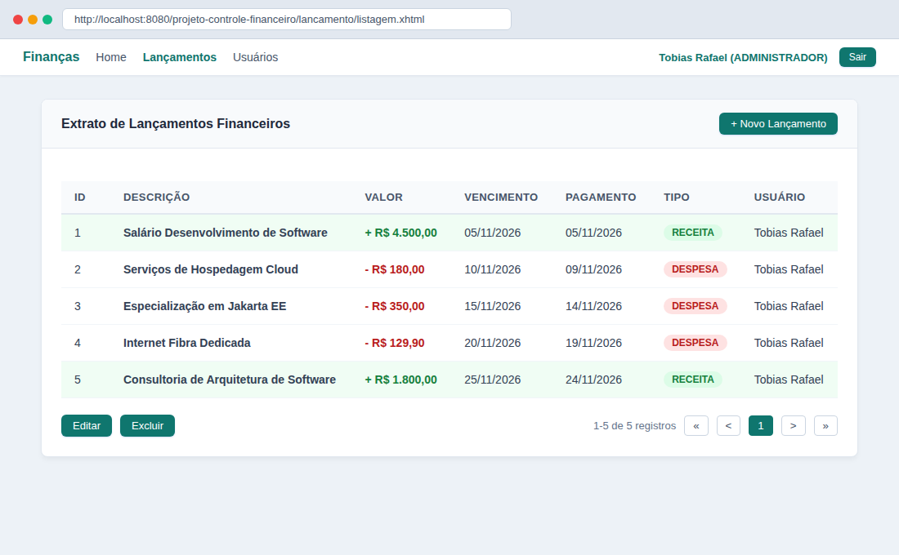
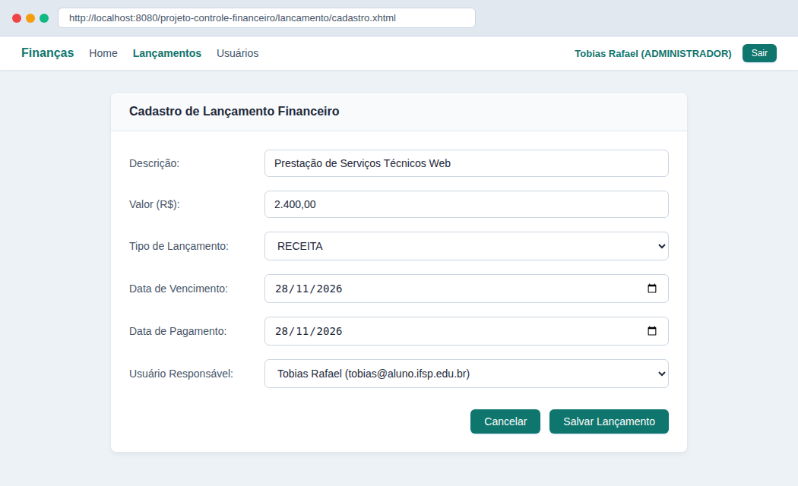
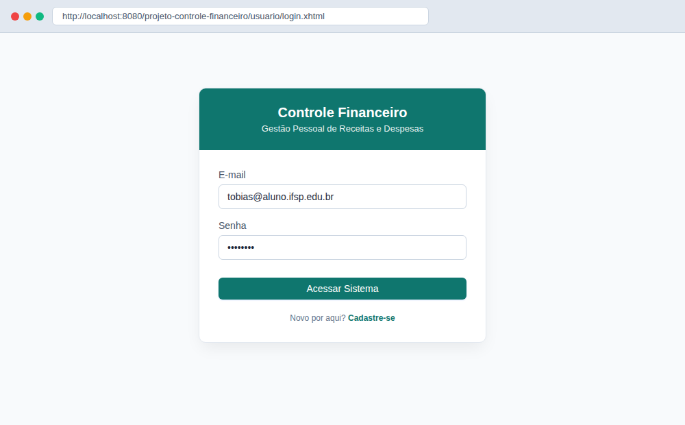

# Projeto de Controle Financeiro Pessoal com Jakarta Faces e JPA

Aplicacao web para gestao e controle de financas pessoais desenvolvida em Java utilizando a especificacao Jakarta EE 10, Jakarta Faces 4.0 (JSF), PrimeFaces 13, JPA (EclipseLink) e banco de dados MySQL. O sistema permite o gerenciamento completo de receitas e despesas, discriminadas por usuario, data, descricao e valor, com controle de autenticacao e niveis de permissao diferenciados.

Projeto desenvolvido no âmbito dos estudos do curso de Ciência da Computação no IFSP.

## Principais Funcionalidades

* Autenticacao e Gestao de Usuarios:
  * Cadastro de novos usuarios com validacao de campos.
  * Autenticacao via tela de login com redirecionamento de acordo com o status da sessao.
  * Perfis de acesso: nivel COMUM e nivel ADMINISTRADOR.
* Gestao de Lancamentos Financeiros:
  * Cadastro de lancamentos categorizados como RECEITA ou DESPESA.
  * Edicao e exclusao de lancamentos existentes.
  * Listagem dinamica de lancamentos associados ao usuario autenticado, com exibicao de datas, valores e tipos.
* Componentes Ricos de Interface:
  * Utilizacao de componentes PrimeFaces (DataTable, CommandButton, InputText, SelectOneMenu, Calendar).
  * Menus de navegacao e templates reutilizaveis.
* Conversores e Listeners:
  * Converter customizado para mapeamento e selecao de entidades Usuario.
  * Listener de ciclo de vida JSF (CicloVidaListener) para acompanhamento das fases de processamento da requisicao.
* Integracao e Persistencia:
  * Mapeamento objeto-relacional (ORM) com Jakarta Persistence 3.0 (EclipseLink).
  * Criacao e gerenciamento automatico de schema via datasource embutido no descritor GlassFish.

## Arquitetura e Estrutura de Pacotes

* `br.edu.ifsp.pep.entidade`: Entidades de dominio mapeadas com anotacoes JPA (`Usuario`, `Lancamento`, `TipoLancamento`, `NivelUsuario`).
* `br.edu.ifsp.pep.controller`: Managed Beans CDI/JSF gerenciando estado de telas e fluxos de navegacao (`LoginController`, `UsuarioController`, `LancamentoController`).
* `br.edu.ifsp.pep.dao`: Camada de acesso a dados baseada no padrao DAO generico (`AbstractDAO`, `UsuarioDao`, `LancamentoDao`).
* `br.edu.ifsp.pep.converter`: Conversores Faces para associacao de identificadores e objetos no ciclo de vida web.
* `br.edu.ifsp.pep.listener`: Interceptadores de ciclo de vida das fases do Jakarta Faces.
* `src/main/webapp/`: Paginas XHTML com visões de cadastro, login, listagem e edicao de lancamentos.
* `src/main/webapp/WEB-INF/glassfish-resources.xml`: Configuracao do connection pool JDBC (`mysql_db_jpa_rootPool`) e JNDI `java:app/jdbc/db_jpa`.

## Como Configurar e Executar

### Pre-requisitos
* Java Development Kit (JDK) 17 ou superior.
* Apache Maven 3.8+.
* Servidor de Aplicacoes GlassFish 7 (ou Payara 6).
* MySQL Server 8 instalado localmente na porta padrao (3306).

### 1. Configuracao do Banco de Dados
A aplicacao utiliza a base de dados `db_jpa` no MySQL. Verifique se o MySQL esta rodando localmente na porta 3306. As configuracoes de credenciais e URL estao definidas no arquivo `src/main/webapp/WEB-INF/glassfish-resources.xml` e criam o banco e tabelas automaticamente no primeiro deploy.

### 2. Compilacao e Geracao do Pacote WAR
Na raiz do projeto, execute:

```bash
mvn clean package
```

O comando produzira o arquivo `target/projeto-inicial-1.0-SNAPSHOT.war`.

### 3. Deploy
Faca o deploy do arquivo WAR gerado no GlassFish 7 via console web de administracao (`http://localhost:4848`) ou via comando CLI:

```bash
asadmin deploy target/projeto-inicial-1.0-SNAPSHOT.war
```

Acesse a aplicacao no navegador:
`http://localhost:8080/projeto-inicial-1.0-SNAPSHOT/`

## Demonstracao da Interface Web

### Extrato e Listagem de Lancamentos
Listagem dinamica de lancamentos financeiros com discriminacao de valores, datas de vencimento/pagamento, status de receitas e despesas com PrimeFaces:



### Cadastro de Lancamento Financeiro
Formulario estruturado para inclusao de novas transacoes com definicao de tipo (Receita ou Despesa), valores e datas:



### Tela de Autenticacao
Acesso seguro ao sistema com controle de usuario e perfis de permissao:


